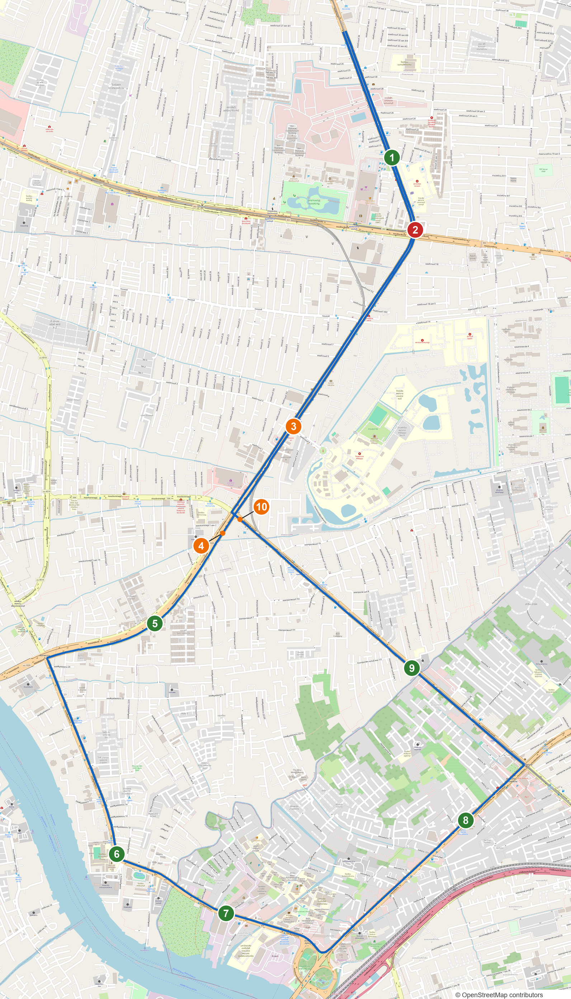

# แผนขับทดสอบ — วงรอบติวานนท์ นนทบุรี

ทดสอบอุปกรณ์บนถนนจริง (GPS → กรองทิศ → beep → เสียงพูด) วงรอบเดียว 15.8 กม. จุดเสี่ยง 10 จุด ครบสามระดับ

> ⚠️ **9 จาก 10 จุดเป็นข้อมูลสมมติ** ตำแหน่งมาจากวงที่ผู้ใช้วาดบนภาพแผนที่ ตัวเลขอุบัติเหตุแต่งขึ้น
> ให้ SI ตกตามระดับของสีวง **ห้ามนำไปรายงานปนกับชุด MOT** (ทุกจุดมี `"synthetic": true`)
> จุดจริงมีวงเดียวคือ `zone_279` ซึ่งเป็นคลัสเตอร์เดียวของชุดหลักที่อยู่บนเส้นทางนี้



## เส้นทาง

เริ่มถนนติวานนท์ฝั่งขาลงใต้ (13.870949, 100.517595) → สี่แยกแคราย → สามแยกศรีธัญญา →
แยกติวานนท์ ตรงเข้าถนนนครอินทร์ → เลี้ยวซ้ายสี่แยกพระราม 5 เข้าถนนพิบูลสงคราม → ผ่าน มจพ. →
แยกพิบูลสงคราม เลี้ยวซ้ายเข้าถนนวงศ์สว่าง → แยกวงศ์สว่าง เลี้ยวซ้ายเข้าถนนกรุงเทพ-นนทบุรี →
แยกติวานนท์ เลี้ยวขวาเข้าถนนติวานนท์ขาขึ้นเหนือ กลับจุดเริ่ม

## จุดเสี่ยงตามลำดับที่เจอ

| # | id | ระดับ | กม. | ตำแหน่ง | ประโยคที่ต้องได้ยิน (หลัง "ข้างหน้าอีก 500 เมตร") |
|---|---|---|---|---|---|
| 1 | `tw_01` | 🟢 ต่ำ | 0.87 | ติวานนท์ ปากซอย 20 | ใกล้จุดเสี่ยงต่ำ โปรดขับขี่ด้วยความระมัดระวัง |
| 2 | `tw_02` | 🔴 สูง | 1.36 | สี่แยกแคราย | ใกล้จุดเสี่ยงสูง โปรดใช้ความเร็วให้เหมาะสม และขับขี่ระมัดระวังเป็นพิเศษ |
| 3 | `tw_03` | 🟠 ปานกลาง | 2.85 | สามแยกศรีธัญญา | ใกล้จุดเสี่ยงปานกลาง โปรดลดความเร็ว และระวังรถตัดผ่านทางแยก |
| 4 | `tw_04` | 🟠 ปานกลาง | 3.68 | นครอินทร์ ถัดแยกติวานนท์ | ใกล้จุดเสี่ยงปานกลาง โปรดเว้นระยะห่างจากคันหน้า และระวังรถเปลี่ยนช่องทาง |
| 5 | `tw_05` | 🟢 ต่ำ | 4.41 | นครอินทร์ ป้าย นบ.1020 | ใกล้จุดเสี่ยงต่ำ โปรดขับขี่ด้วยความระมัดระวัง |
| 6 | `tw_06` | 🟢 ต่ำ | 6.49 | โค้งพิบูลสงคราม | ใกล้จุดเสี่ยงต่ำ โปรดขับขี่ด้วยความระมัดระวัง |
| 7 | `zone_279` | 🟢 ต่ำ (จริง) | 7.30 | พิบูลสงคราม ก่อนถึง มจพ. | ใกล้จุดเสี่ยงต่ำ โปรดขับขี่ด้วยความระมัดระวัง |
| 8 | `tw_07` | 🟢 ต่ำ | 9.25 | วงศ์สว่าง | ใกล้จุดเสี่ยงต่ำ โปรดขับขี่ด้วยความระมัดระวัง |
| 9 | `tw_08` | 🟢 ต่ำ | 10.73 | กรุงเทพ-นนทบุรี รอยต่อจังหวัด | ใกล้จุดเสี่ยงต่ำ โปรดขับขี่ด้วยความระมัดระวัง |
| 10 | `tw_09` | 🟠 ปานกลาง | 12.19 | กรุงเทพ-นนทบุรี ก่อนแยกติวานนท์ | ใกล้จุดเสี่ยงปานกลาง โปรดใช้ความเร็วให้เหมาะสม และขับขี่ระมัดระวัง |

ขากลับบนติวานนท์จะเตือน `tw_03` → `tw_02` → `tw_01` ซ้ำอีกรอบ เป็นเรื่องปกติ เพราะออกนอก 600 ม. ไปแล้ว

## เสียงเตือนที่คาดไว้ล่วงหน้า (จำลองขับ 200 รอบต่อความเร็ว ไม่ใช่ความผิดปกติใหม่)

| ตำแหน่งรถ | ได้ยิน | เหตุผล |
|---|---|---|
| ติวานนท์ขาลงใต้ ราวกม. 3.1 | `tw_09` ทั้งที่รถไม่ได้ผ่านจุดนั้น | จุดอยู่ตรงแนวหน้ารถพอดีที่แยกติวานนท์ เป็นการเตือนผิดจากถนนใกล้กัน |
| กรุงเทพ-นนทบุรี ราวกม. 11.9 | `tw_04` ทั้งที่รถจะเลี้ยวขวาขึ้นเหนือ | เหตุผลเดียวกัน ห่างจาก `tw_09` เพียง 143 ม. |

ทั้งสองกรณีให้จดลงใบตรวจเป็นตัวอย่างเตือนผิดบริเวณทางแยก

`tw_04` ขากลับมักพูดระยะ 450 เมตร ซึ่งไม่มีไฟล์อัดไว้ ระบบจะใช้เสียง Google (ต้องมีเน็ต) ถ้าไม่มีเน็ตจะเป็น espeak
เสียงจะต่างจากประโยคอื่น ตอนจำลองเกิดแบบเดียวกันกับจุดอื่นได้ราว 5% เมื่อขับเร็วและเพิ่งพูดประโยคก่อนหน้าจบ

## ตั้งค่าบน Pi ก่อนออกรถ

```bash
cd ~/mtec-risk-alert-system && git pull
sudo nano /etc/mtec.env
#   RISK_DATA_FILE=data/risk_points_tiwanon_test.geojson
#   ALERT_RADIUS_M=500
#   EXIT_RADIUS_M=600
sudo systemctl restart mtec-api mtec-alert-client
curl -s localhost:8000/api/health     # dataset ต้องเป็น risk_points_tiwanon_test.geojson
```

หลังทดสอบเสร็จ เปลี่ยน `RISK_DATA_FILE` กลับเป็น `data/risk_points_bkk_metro_3y.geojson` แล้ว restart สองตัวเดิม

ดูบนมือถือ: `https://milo007z-ui.github.io/mtec-risk-alert-system/test-tiwanon.html`
ซ้อมในห้อง: เติม `?mock=1` ท้ายลิงก์ ครบวงราว 8 นาที

## ใบตรวจระหว่างขับ

ให้คนนั่งข้างจดหรืออัดวิดีโอ คนขับไม่ต้องดูจอ

| # | เตือนไหม | ระยะจริงตอนเตือน | ประโยคถูกไหม | beep เร่งจังหวะไหม | หมายเหตุ |
|---|---|---|---|---|---|
| 1–10 ขาไป | | | | | |
| 3, 2, 1 ขากลับ | | | | | |

## สร้างชุดข้อมูลใหม่

```bash
python scripts/build_tiwanon_test_site.py    # ต้องต่อเน็ต ใช้ OSRM สร้างเส้นทาง
```
